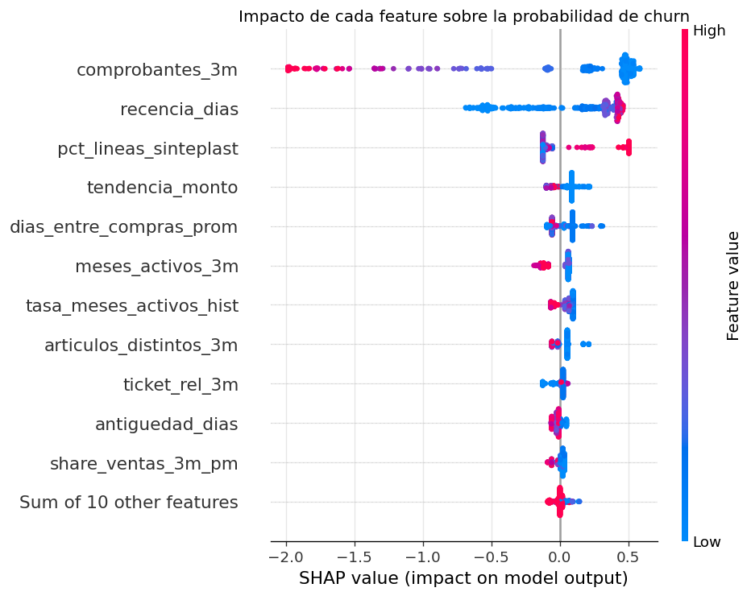

# Predicción de abandono mensual de clientes — Pinturería

Proyecto final del curso de **Data Science de Coderhouse**.
Autor: **Pablo Ferres**

Modelo de Machine Learning que, al cierre de cada mes, estima la probabilidad de que cada cliente de una pinturería **no vuelva a comprar el mes siguiente**. Con eso el equipo comercial puede priorizar a quién contactar antes de perderlo.

---

## Resultados principales

| Modelo | ROC-AUC CV | ROC-AUC test | PR-AUC test |
|---|---|---|---|
| Dummy (baseline) | 0,500 | 0,500 | 0,747 |
| Regla de negocio (recencia) | 0,825 | 0,821 | 0,917 |
| Regresión logística | 0,855 | 0,852 | 0,929 |
| Random Forest | 0,860 | 0,857 | 0,934 |
| **XGBoost (seleccionado)** | **0,860** | **0,862** | **0,934** |

En el punto de operación (umbral 0,68, fijado en validación para capturar al menos el 80 % de los clientes que se van), el modelo obtiene en test **recall 84 % con precisión 90 %**.

**Variables más influyentes (SHAP):** comprobantes de los últimos 3 meses, días desde la última compra, proporción de compras de la marca principal y tendencia del monto mensual.



---

## Problema

| | |
|---|---|
| **Tipo de tarea** | Clasificación binaria supervisada |
| **Unidad de análisis** | Cliente identificado × mes (se excluye "Consumidor Final") |
| **Variable objetivo** | `churn_mes_siguiente` = 1 si el cliente no compra (FC/TK) en el mes *t+1* |
| **Métrica de selección** | ROC-AUC, porque el objetivo es *ordenar* a los clientes por riesgo |
| **Métricas complementarias** | PR-AUC, precisión y recall en el umbral de negocio |
| **Validación** | Temporal: train = fotos ene–sep 2025, test = oct–nov 2025; CV *walk-forward* por mes |

## Datos

- **Fuente:** registros de ventas de una pinturería (pinturas de obra y repintado automotor: Sinteplast, Glasurit, abrasivos, diluyentes, herramientas), línea por línea de **enero a diciembre de 2025**. Son 24.954 líneas, 8.844 comprobantes, 299 clientes y 1.857 artículos.
- **Archivo publicado:** `data/processed/ventas_anonimizado.csv`, ya anonimizado:
  - Se eliminaron los nombres de clientes y vendedores.
  - El código de cliente se reemplazó por un hash SHA-256 con sal privada.
  - Se corrigieron caracteres mal codificados en las descripciones.
- El archivo original (`data/raw/`) **no** se publica (está en `.gitignore`). El script `src/anonimizar.py` documenta cómo se generó el CSV.

### Diccionario de columnas (CSV anonimizado)

| Columna | Descripción |
|---|---|
| `FECHA`, `HORA` | Fecha y hora del comprobante |
| `PUNTO DE VENTA`, `TIPO`, `LETRA`, `NUMERO COMPROBANTE` | Identificación del comprobante (FC factura, TK ticket, NC nota de crédito, ND nota de débito) |
| `ID_CLIENTE` | Cliente anonimizado (`CONSUMIDOR_FINAL` para ventas anónimas) |
| `COD VENDEDOR` | Código del vendedor |
| `COD ARTICULO`, `DESCRIPCION` | Artículo vendido |
| `COD MARCA`, `MARCA` | Marca (sólo cargada para Sinteplast) |
| `COD PROVEEDOR`, `PROVEEDOR` | Proveedor del artículo |
| `COSTO` | Costo unitario |
| `CANTIDAD`, `PRECIO UNITARIO`, `DESCUENTO (%)`, `PRECIO TOTAL` | Importes de la línea |
| `SUCURSAL`, `TIPO VENTA`, `MEDIO DE PAGO`, `RECARGO (%)` | Constantes en el período (no informativas) |

## Estructura del repositorio

```
.
├── data/
│   └── processed/
│       └── ventas_anonimizado.csv      # dataset publicado (anonimizado)
├── notebooks/
│   └── TP_Final_Churn_Pintureria.ipynb # pipeline completo, ejecutado con outputs
├── src/
│   ├── anonimizar.py                   # genera el CSV anonimizado desde el Excel original
│   ├── features.py                     # carga de ventas y construcción del panel cliente-mes
│   └── modelado.py                     # split temporal, CV walk-forward, preprocesamiento, métricas, umbral
├── reports/
│   ├── figures/                        # todos los gráficos del notebook (PNG)
│   └── metricas.json                   # métricas finales e hiperparámetros del modelo elegido
├── requirements.txt
└── README.md
```

## Cómo reproducir

**Requisitos:** Python 3.12 (probado con 3.12.3).

```bash
# 1. Clonar el repositorio
git clone https://github.com/pabloferres49/tp-final-churn-pintureria.git
cd tp-final-churn-pintureria

# 2. Crear el entorno e instalar dependencias
python -m venv .venv
source .venv/bin/activate          # Windows: .venv\Scripts\activate
pip install -r requirements.txt

# 3a. Abrir el notebook y ejecutar todas las celdas (Kernel > Restart & Run All)
jupyter notebook notebooks/TP_Final_Churn_Pintureria.ipynb

# 3b. ...o ejecutarlo de punta a punta desde la terminal
jupyter nbconvert --to notebook --execute --inplace notebooks/TP_Final_Churn_Pintureria.ipynb
```

La ejecución completa tarda unos 2 minutos en una notebook común. El notebook:
- lee `data/processed/ventas_anonimizado.csv`,
- regenera todas las figuras en `reports/figures/`,
- guarda el modelo entrenado en `models/modelo_churn.joblib` (con su umbral y la lista de features),
- guarda las métricas en `reports/metricas.json`.

**Reproducibilidad:** semilla fija (`SEED = 42`) en todos los modelos, versiones de librerías fijadas en `requirements.txt` y validación sin aleatoriedad (partición temporal).

### Ejecutar en Google Colab

```python
!git clone https://github.com/pabloferres49/tp-final-churn-pintureria.git
%cd tp-final-churn-pintureria
!pip install -q xgboost==3.4.1 shap==0.54.1
```
Después, abrí `notebooks/TP_Final_Churn_Pintureria.ipynb` o ejecutá su contenido. El notebook detecta solo la carpeta raíz del repositorio.

### (Opcional) Regenerar el CSV anonimizado desde el Excel original

Sólo es posible con acceso al archivo original, que no se publica:

```bash
export ANON_SALT="<sal-privada>"
python src/anonimizar.py --input data/raw/Data_Set_Pintureria_normalizado.xlsx \
                         --output data/processed/ventas_anonimizado.csv
```

## Pipeline

1. **Formulación del problema:** objetivo, unidad de análisis y métricas alineadas con el negocio.
2. **Carga y control de calidad:** detección de columnas constantes, faltantes estructurales (marca), duplicados, importes negativos y diferencias de cálculo en `PRECIO TOTAL`.
3. **EDA:** evolución mensual (efecto inflación), concentración de ventas (Pareto: el 20 % de los clientes explica el 83 % de las ventas), recurrencia (46 % de los clientes compró en un solo mes), descuentos y márgenes.
4. **Ingeniería de atributos:** panel cliente-mes con 17 features calculados sin fuga de datos. Incluye RFM, regularidad, montos relativos al total del local (para neutralizar la inflación), tendencia, canasta, margen, devoluciones y vendedor.
5. **Entrenamiento y optimización:** `Pipeline` + `GridSearchCV` con CV *walk-forward* para Regresión Logística, Random Forest y XGBoost.
6. **Selección y evaluación:** comparación con baselines, curvas ROC y PR, umbral de negocio, matriz de confusión, curva de ganancia y estabilidad por mes.
7. **SHAP:** importancia global, beeswarm, dependencia y explicación individual (waterfall).
8. **Conclusiones:** recomendaciones comerciales y limitaciones.

## Limitaciones

- Un solo año de historia y ~300 clientes identificados. No se puede modelar estacionalidad anual, y la antigüedad está censurada a la izquierda.
- La inflación se mitiga con features relativos, pero no se deflactan los montos con un índice externo.
- El sistema no tiene cargados el medio de pago ni la mayoría de las marcas.
- Churn definido a 1 mes. Una ventana de 60/90 días podría representar mejor a los clientes de ciclo largo.
